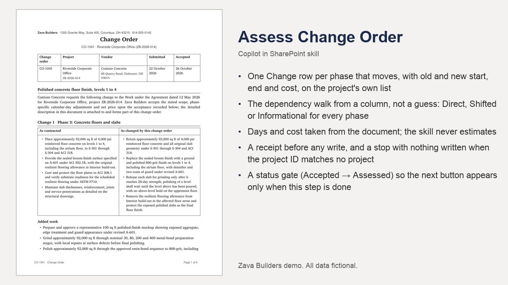

# Assess Change Order

Reads an accepted construction change order, matches its project by ID, follows the project's dependency chain to find every phase that moves, and records the impact as rows for a person to review.

## What you get

- One Change row per phase that moves, with old and new start, end and cost, on the project's own list
- The dependency walk from a column, not a guess: Direct, Shifted or Informational for every phase
- Days and cost taken from the document; the skill never estimates
- A receipt before any write, and a stop with nothing written when the project ID matches no project
- A status gate (Accepted → Assessed) so the next button appears only when this step is done
- The arithmetic in references/propagation.md, which a business owner edits instead of the skill

Also available in the PnP SharePoint Skills library: [https://github.com/pnp/sharepoint-skills/tree/main/Skills/assess-change-order](https://github.com/pnp/sharepoint-skills/tree/main/Skills/assess-change-order)

Watch it run: [Copilot in SharePoint for Construction (video)](https://www.youtube.com/watch?v=oblKIcqcUDI)

## Install

Upload the inner `assess-change-order/` folder (SKILL.md and references/) into the site's **Agent Assets › Skills** folder. The folder name must match the `name` in SKILL.md. Open the Copilot pane and type `/` to see it.

This skill names its lists and libraries by full address in `references/site.md`. Before uploading, replace `https://YOUR-TENANT.sharepoint.com/sites/YOUR-SITE` and `https://YOUR-TENANT.sharepoint.com` there with your site and tenant. The lists, columns and sample files it expects, and the other two skills of the chain, are in the demo repository's setup guide. The rules it follows are in `references/site.md` and `references/propagation.md`.

## SharePoint Skill

| Solution | Author(s) |
| --- | --- |
| assess-change-order | Hassan Moses &#124; [GitHub](https://github.com/HassanJMoses) |

## Version history

| Version | Date | Comments |
| --- | --- | --- |
| 1.0 | November 2026 | Initial release |

## Disclaimer

**THIS CODE IS PROVIDED _AS IS_ WITHOUT WARRANTY OF ANY KIND, EITHER EXPRESS OR IMPLIED, INCLUDING ANY IMPLIED WARRANTIES OF FITNESS FOR A PARTICULAR PURPOSE, MERCHANTABILITY, OR NON-INFRINGEMENT.**

All companies, people, projects, contracts and figures in the sample files are fictional, created for a product demonstration.

