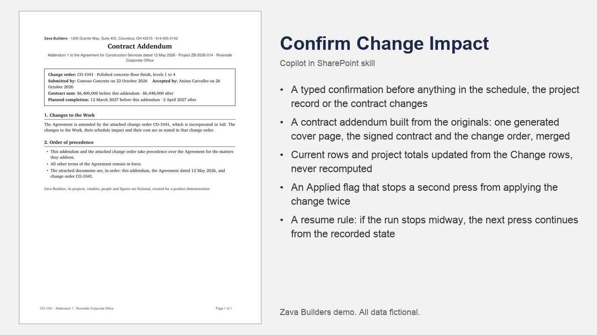

# Confirm Change Impact

Asks a person to confirm an assessed change order's impact, then applies the new dates and cost to the schedule and builds the contract addendum: cover sheet, signed contract, change order, merged into one PDF.

## What you get

- A typed confirmation before anything in the schedule, the project record or the contract changes
- A contract addendum built from the originals: one generated cover page, the signed contract and the change order, merged
- Current rows and project totals updated from the Change rows, never recomputed
- An Applied flag that stops a second press from applying the change twice
- A resume rule: if the run stops midway, the next press continues from the recorded state
- The merge recipe in references/addendum.md

Also available in the PnP SharePoint Skills library: [https://github.com/pnp/sharepoint-skills/tree/main/Skills/confirm-change-impact](https://github.com/pnp/sharepoint-skills/tree/main/Skills/confirm-change-impact)

Watch it run: [Copilot in SharePoint for Construction (video)](https://www.youtube.com/watch?v=oblKIcqcUDI)

## Install

Upload the inner `confirm-change-impact/` folder (SKILL.md and references/) into the site's **Agent Assets › Skills** folder. The folder name must match the `name` in SKILL.md. Open the Copilot pane and type `/` to see it.

This skill names its lists and libraries by full address in `references/site.md`. Before uploading, replace `https://YOUR-TENANT.sharepoint.com/sites/YOUR-SITE` and `https://YOUR-TENANT.sharepoint.com` there with your site and tenant. The lists, columns and sample files it expects, and the other two skills of the chain, are in the demo repository's setup guide. The rules it follows are in `references/site.md` and `references/addendum.md`.

## SharePoint Skill

| Solution | Author(s) |
| --- | --- |
| confirm-change-impact | Hassan Moses &#124; [GitHub](https://github.com/HassanJMoses) |

## Version history

| Version | Date | Comments |
| --- | --- | --- |
| 1.0 | November 2026 | Initial release |

## Disclaimer

**THIS CODE IS PROVIDED _AS IS_ WITHOUT WARRANTY OF ANY KIND, EITHER EXPRESS OR IMPLIED, INCLUDING ANY IMPLIED WARRANTIES OF FITNESS FOR A PARTICULAR PURPOSE, MERCHANTABILITY, OR NON-INFRINGEMENT.**

All companies, people, projects, contracts and figures in the sample files are fictional, created for a product demonstration.

