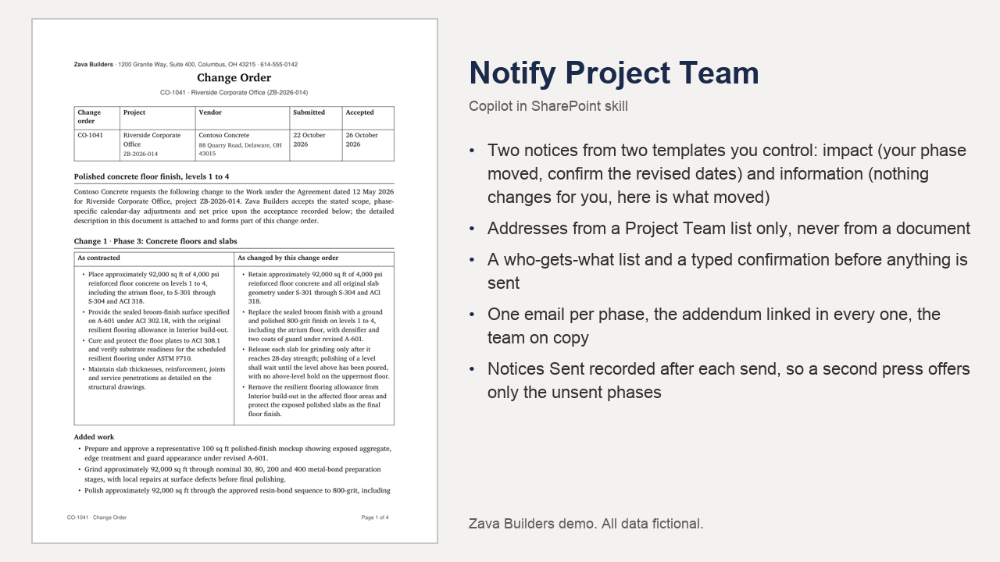

# Notify Project Team

Tells every phase manager on a project about a reviewed change order: an impact notice for phases that moved, an information notice for the rest, each linking the addendum, sent only after "Confirm to send".

## What you get

- Two notices from two templates you control: impact (your phase moved, confirm the revised dates) and information (nothing changes for you, here is what moved)
- Addresses from a Project Team list only, never from a document
- A who-gets-what list and a typed confirmation before anything is sent
- One email per phase, the addendum linked in every one, the team on copy
- Notices Sent recorded after each send, so a second press offers only the unsent phases
- The placeholder map in references/notices.md and the templates in the Email Templates library

Also available in the PnP SharePoint Skills library: [https://github.com/pnp/sharepoint-skills/tree/main/Skills/notify-project-team](https://github.com/pnp/sharepoint-skills/tree/main/Skills/notify-project-team)

Watch it run: [Copilot in SharePoint for Construction (video)](https://www.youtube.com/watch?v=oblKIcqcUDI)

## Install

Upload the inner `notify-project-team/` folder (SKILL.md and references/) into the site's **Agent Assets › Skills** folder. The folder name must match the `name` in SKILL.md. Open the Copilot pane and type `/` to see it.

This skill names its lists and libraries by full address in `references/site.md`. Before uploading, replace `https://YOUR-TENANT.sharepoint.com/sites/YOUR-SITE` and `https://YOUR-TENANT.sharepoint.com` there with your site and tenant. The lists, columns and sample files it expects, and the other two skills of the chain, are in the demo repository's setup guide. The rules it follows are in `references/site.md` and `references/notices.md`.

## SharePoint Skill

| Solution | Author(s) |
| --- | --- |
| notify-project-team | Hassan Moses &#124; [GitHub](https://github.com/HassanJMoses) |

## Version history

| Version | Date | Comments |
| --- | --- | --- |
| 1.0 | November 2026 | Initial release |

## Disclaimer

**THIS CODE IS PROVIDED _AS IS_ WITHOUT WARRANTY OF ANY KIND, EITHER EXPRESS OR IMPLIED, INCLUDING ANY IMPLIED WARRANTIES OF FITNESS FOR A PARTICULAR PURPOSE, MERCHANTABILITY, OR NON-INFRINGEMENT.**

All companies, people, projects, contracts and figures in the sample files are fictional, created for a product demonstration.

